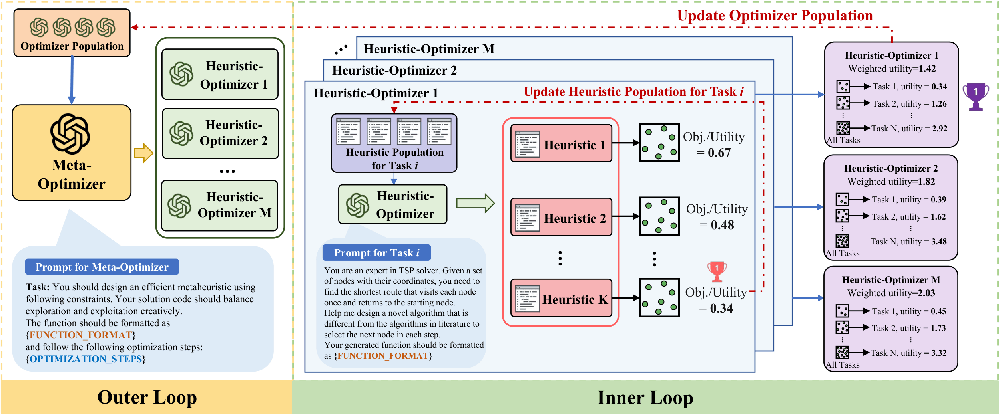

<h1 align="center"> [ICLR 2026] Generalizable Heuristic Generation Through LLMs with Meta-Optimization </h1>

<p align="center">
<a href="https://iclr.cc/virtual/2026/poster/10006991"></a>&nbsp;&nbsp;&nbsp;&nbsp;
<a href="https://arxiv.org/pdf/2505.20881"></a>&nbsp;&nbsp;&nbsp;&nbsp;
<a href="https://github.com/yiding-s/MoH"></a>&nbsp;&nbsp;&nbsp;&nbsp;
<a href="https://github.com/yiding-s/MoH/blob/main/LICENSE"></a>
</p>

This repository contains the official implementation of **MoH (Meta-optimization of Heuristics)**, a novel framework for generating heuristics through Large Language Models with meta-optimization techniques.

## Overview
<p align="center">
  
</p>

---

## Installation

```bash
# Clone the repository
git clone https://github.com/yiding-s/MoH.git
cd MoH

# Install with uv (recommended)
uv sync

# Or install with pip
pip install -e .
```

**Dependencies**: `numpy`, `tqdm`, `hydra-core`, `omegaconf`, `openai`, `numba`, `func-timeout` (see `pyproject.toml` for full list). Require Python >= 3.12.

### Run diagnostics and checks

From the repository root, run `uv run pytest -q` and `uv run ruff check .`.
The root uv workspace installs the MoH dependencies and test tools.

New runs retain raw LLM requests and responses in `logs/llm/heu/` and
`logs/llm/meta/` under the run output directory. A configured `cache_dir`
changes the base directory; each role still gets its own subdirectory.
Extraction failures and the number of new heuristic evaluations per subtask
and outer iteration are written to the run log.

`accepted=True` now means the optimizer code changed and its returned utility
strictly improved. Returning the existing optimizer or an equal/worse score
keeps the previous optimizer and records `accepted=False`. A zero gap is valid.

Generated optimizers load and execute in subprocesses. `optimizer_timeout`
limits execution (default 3600 seconds); loading validation is capped at 90
seconds. `seed` controls population selection and generated optimizer RNGs
(default 0); external LLM responses and the GLS wall-clock budget can still vary.

TSP-GLS validation samples 8 unique instances from
`problems/tsp_gls/data/val/val_instance_data_sol_<size>.pkl` using the run seed.
Every candidate in a run is evaluated on the same selected indices. Deployment
test mode evaluates the first 100 instances by default from
`problems/tsp_gls/data/test/test_instance_data_sol_<size>.pkl`. Both modes require
enough instances and log the data file, seed and selected indices. Evaluation
uses at most 8 workers. Scores from older runs that used test data for validation
must be recomputed before reusing their populations with the new validation split.

### Behavior-diverse heuristic populations

Inner heuristic populations (`subtask_pop` in training and target populations in deployment) retain both high-quality elites and behaviorally complementary heuristic candidates using `population.diversity_fraction` (default: `0.3`).

#### Survivor Selection Policy
- **Floor Rounding:** For a population capacity $K$ and diversity fraction $f$, $K - \lfloor K \times f \rfloor$ slots are reserved for quality elites (ranked by mean gap ascending, then cleaned code SHA-256 ascending). The remaining $\lfloor K \times f \rfloor$ slots are filled greedily to maximize the minimum behavior distance to already selected survivors. For example, capacity 10 with fraction 0.3 yields 7 elite slots and 3 diversity slots.
- **Behavior Distance:** Distance between two candidates is the root-mean-square coordinate difference of $\log(1 + \text{gap})$ across all validation instances. Ties in distance are broken deterministically by quality rank.
- **Failure Exclusion:** Candidates with any failed instances or nonfinite gap values are completely excluded from admission. Evaluation failure penalties never become novelty rewards.
- **Order Dependence:** Greedy max-min selection occurs over current survivors plus the newly evaluated candidate. Sequential arrival order can affect intermediate survivors; identical candidate insertion sequences and seeds reproduce exact populations.
- **Identity Matching & Legacy Reevaluation:** Descriptors are bound to an immutable `EvaluationIdentity` (`size, mode, dataset_sha256, indices, seed, solver_settings`). Loading existing or legacy population snapshots lacking matching descriptors triggers automated reevaluation on current validation instances before admission.
- **Quality-only Ablation:** Setting `population.diversity_fraction=0` enables a quality-only baseline. This ablation retains the same strict validation, identity matching, and deterministic tie-breaking without diversity slots. Valid measured vectors are still required.

#### Experimental Ablation Commands
Run these commands from the `MoH/` directory:

```bash
# Training: Quality-only baseline (fraction = 0) vs. Behavior-diverse (fraction = 0.3)
uv run python main.py population.diversity_fraction=0 seed=0
uv run python main.py population.diversity_fraction=0.3 seed=0

# Deployment: Quality-only baseline vs. Behavior-diverse
uv run python deploy.py checkpoint=/absolute/path/to/checkpoint population.diversity_fraction=0
uv run python deploy.py checkpoint=/absolute/path/to/checkpoint population.diversity_fraction=0.3
```

#### Reproducibility & Evaluation Notes
Meaningful comparison between diversity and baseline runs requires matched initial seed candidates, random seeds, instance identities, LLM provider configuration, and evaluation call budgets. Random seeds alone do not guarantee identical outputs across external LLM API calls. Diagnostics track `best_mean_gap` and `mean_pairwise_distance` in population snapshots (`.diversity.json` artifacts). Held-out test evaluation occurs strictly after selection and does not influence survivor selection. Improved downstream benchmark performance is a research hypothesis to be evaluated through controlled experiments, not an implementation assumption.

### Triển khai optimizer đã học

Chạy các lệnh sau từ thư mục `MoH`. Khi virtual environment của dự án đã được
kích hoạt, bắt đầu một training run dùng LLM local bằng lệnh:

```bash
export LOCAL_LLM_API_KEY="your-key"
python main.py llm_client@heu=local llm_client@meta=local
```

Log sẽ in ra đường dẫn tuyệt đối của Hydra `Workspace`. Lưu lại đường dẫn này
sau khi training hoàn tất. Các training run mới tự động tạo một checkpoint bất
biến bên trong workspace:

```bash
TRAIN_RUN="/absolute/path/printed/as/Workspace"
CHECKPOINT="$TRAIN_RUN/checkpoint"
test -f "$CHECKPOINT/metadata.json"
```

Nếu training run cũ đã hoàn tất nhưng chưa có thư mục `checkpoint/`, chuyển đổi
các artifact đã lưu bằng lệnh dưới đây. Thư mục output không được tồn tại trước:

```bash
python -m utils.checkpoint \
  --run "$TRAIN_RUN" \
  --output "$PWD/checkpoints/training-run-1"
CHECKPOINT="$PWD/checkpoints/training-run-1"
```

Trước tiên, chạy một deployment nhỏ chỉ dùng validation trên TSP500. Bước này
kiểm tra checkpoint, dữ liệu target, optimizer đã sinh, kết nối LLM và evaluator
cô lập mà không đọc test split:

```bash
RUN_TAG="$(date +%Y%m%d_%H%M%S)"
SMOKE_RUN="$PWD/outputs/deployment/tsp500-smoke-$RUN_TAG"

python deploy.py \
  checkpoint="$CHECKPOINT" \
  'target_sizes=[500]' \
  inference_iterations=1 \
  evaluate_test=false \
  seed=0 \
  "hydra.run.dir=$SMOKE_RUN"
```

Sau đó, triển khai optimizer đã học độc lập trên TSP500 và TSP1000, rồi đánh giá
heuristic được chọn của từng target trên test split:

```bash
DEPLOY_RUN="$PWD/outputs/deployment/tsp500-1000-$RUN_TAG"

python deploy.py \
  checkpoint="$CHECKPOINT" \
  'target_sizes=[500,1000]' \
  inference_iterations=10 \
  val_n_instances=8 \
  test_n_instances=100 \
  workers=8 \
  seed=0 \
  "hydra.run.dir=$DEPLOY_RUN"
```

Deployment mặc định dùng `llm_client@heu=local`. Để dùng OpenAI, đặt biến môi
trường `OPENAI_API_KEY` và thêm `llm_client@heu=openai` vào lệnh deployment.
Cả hai lệnh deployment đều gọi LLM đã cấu hình và có thể phát sinh chi phí từ
provider. Bộ dữ liệu TSP500/TSP1000 đi kèm hiện có 100 test instances, vì vậy
giá trị `test_n_instances` lớn hơn 100 sẽ bị preflight từ chối trước khi gọi LLM.

Checkpoint chỉ lưu optimizer và provenance của training. Khi deployment, hệ
thống tạo population mới cho TSP500 và TSP1000, dùng các training elite đã lưu
làm reference. Mọi candidate được chấm trên validation split của target;
optimizer đã học được chạy theo số inference iterations yêu cầu. Heuristic có
validation gap thấp nhất được đóng băng và chỉ được đánh giá một lần trên test.
Nếu một target thất bại, lỗi sẽ được ghi nhận và target còn lại vẫn tiếp tục.
Test score không được đưa ngược vào quá trình sinh, xếp hạng hoặc lựa chọn.

Xem kết quả cuối bằng lệnh:

```bash
python -m json.tool "$DEPLOY_RUN/report.json"
```

`status=ok` nghĩa là inference và test evaluation đều thành công.
`validation_gap_pct` và `test_gap_pct` càng thấp càng tốt. Generated code,
population snapshots, stdout của evaluator, phản hồi LLM, heuristic được chọn,
`report.json` và `report.csv` được lưu trong `$DEPLOY_RUN`. Hai target heuristic
đã đóng băng nằm tại `heuristics/tsp500.py` và `heuristics/tsp1000.py`.

**Datas**: You can download them from [GoogleDrive](https://drive.google.com/file/d/1e4T8Yiz-qvHcChys2Tk841pbXumGVYu2/view?usp=sharing) and put data folder of each problem under `problems/<problem_name>`, the scripts to generate the data will also be updated in this repository soon.
## Configuration

MoH uses [Hydra](https://hydra.cc/) for configuration management. All config files are located in the `cfg/` directory:

```
cfg/
├── config.yaml              # Main config (iterations, population size, eval_calls_limit, etc.)
├── llm_client/
│   ├── openai.yaml           # OpenAI API config (e.g., gpt-4o)
│   └── ...           # more LLM configurations
├── problem/
│   └── tsp_gls.yaml          # Problem-specific config (TSP-GLS)
└── hydra/output/
    └── local.yaml            # Output directory config
```

**Note: More problems and LLM support coming soon! Since this project has been refactored from the original version, feel free to raise an issue if encounter any unexpected issues. **

### LLM Client Config

**OpenAI API** (`cfg/llm_client/openai.yaml`):
```yaml
model: gpt-4o
batch_size: 5
api_key: ${oc.env:OPENAI_API_KEY}   # Set via environment variable
```

### Problem Config

Each problem is defined in `cfg/problem/`. Example (`tsp_gls.yaml`):
```yaml
problem_name: tsp_gls
obj_type: min
problem_size: [100, 200]
```

## Usage

```bash
# Run with default config (can also modify config in cfg/)
python main.py

# Override parameters from command line
python main.py n_iterations=20 

# Use local LLM (start the server configured in cfg/llm_client/local.yaml first)
export LOCAL_LLM_API_KEY="your-local-server-key"
python main.py llm_client@heu=local llm_client@meta=local

# Change problem size
python main.py problem.problem_size='[50, 100]'
```
Results are saved to `outputs/<problem_name>-<problem_size>/<timestamp>/`.

## Citation

```bibtex
@inproceedings{
shi2026generalizable,
title={Generalizable Heuristic Generation Through {LLM}s with Meta-Optimization},
author={Yiding Shi and Jianan Zhou and Wen Song and Jieyi Bi and Yaoxin Wu and Zhiguang Cao and Jie Zhang},
booktitle={The Fourteenth International Conference on Learning Representations},
year={2026},
url={https://openreview.net/forum?id=tIQZ7pVN6S}
}
```
---
## License

This project is licensed under the MIT License - see the [LICENSE](LICENSE) file for details.

## Acknowledgement
- https://github.com/ai4co/reevo 
- https://github.com/FeiLiu36/EoH
